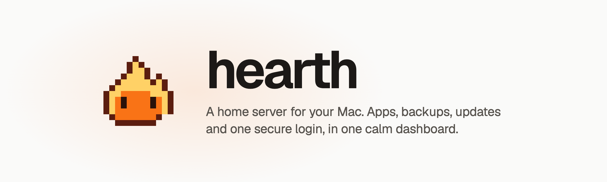
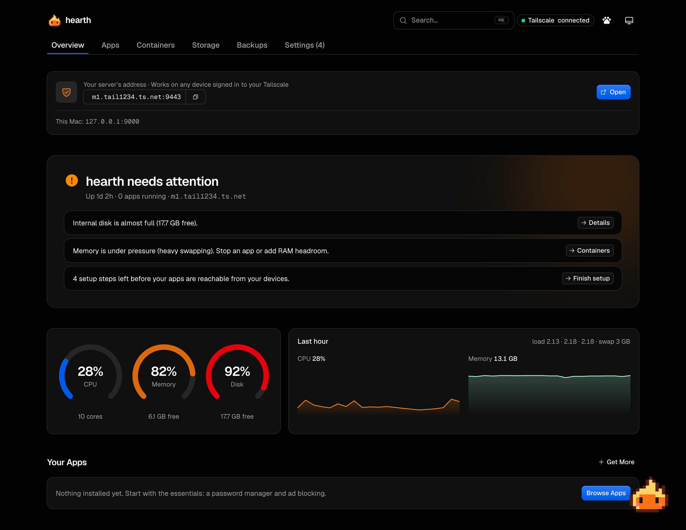
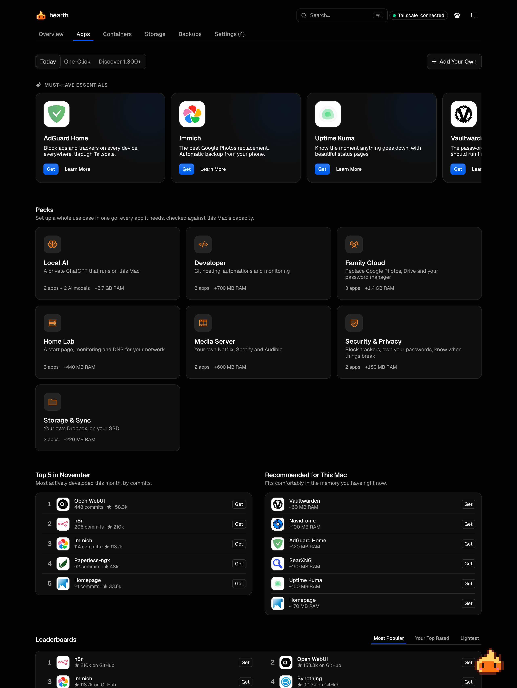
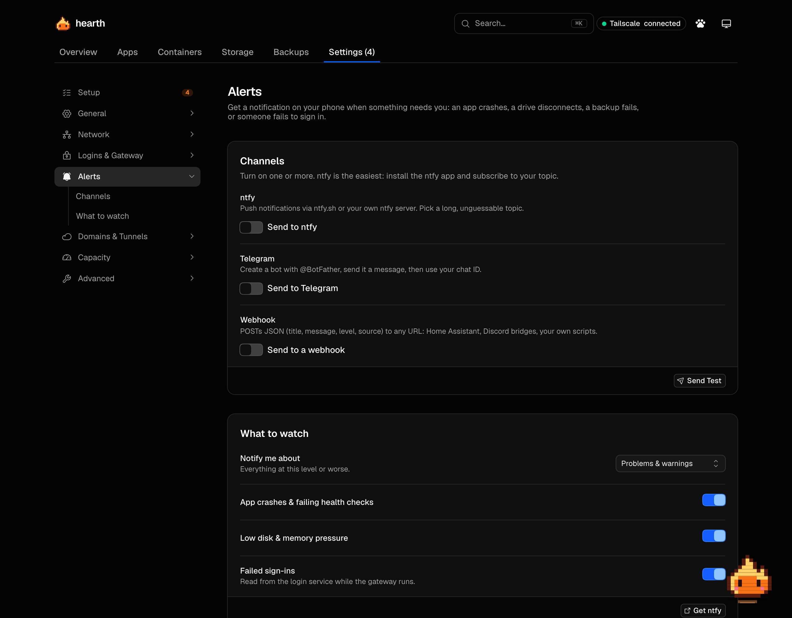
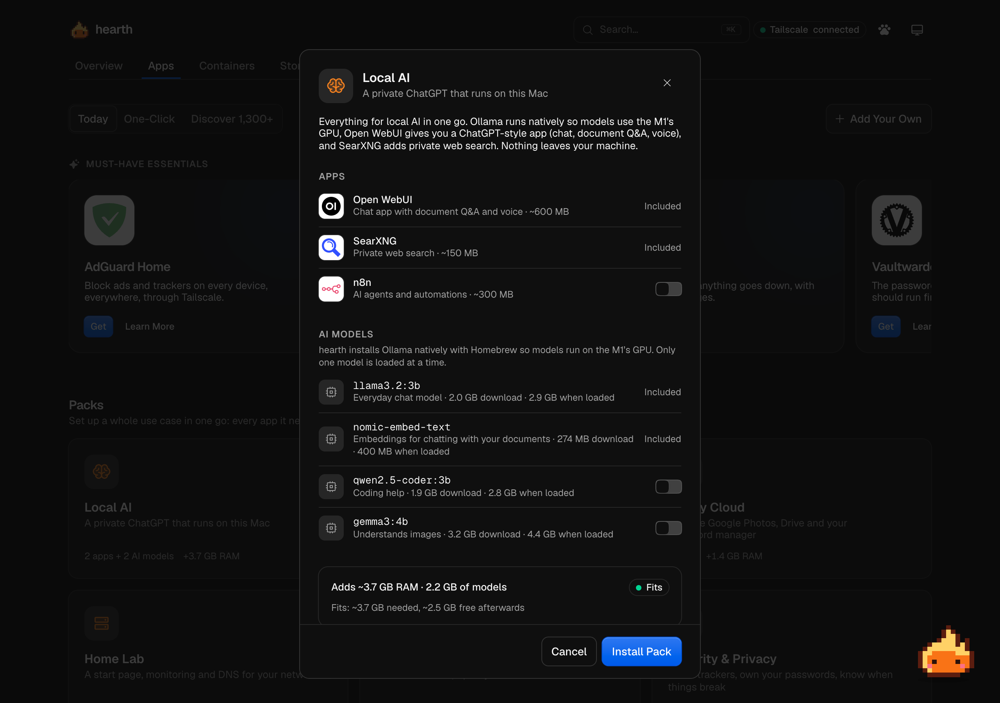

<p align="center">
  <picture>
    <source media="(prefers-color-scheme: dark)" srcset="docs/assets/banner-dark.png">
    
  </picture>
</p>

<p align="center">
  <strong>Turn a spare Mac into a calm, secure home server.</strong><br>
  One-click apps and whole stacks, nightly backups, safe updates and one login in front of everything,<br>
  run by a single native daemon that fits on an 8&nbsp;GB M1.
</p>

<p align="center">
  
  
  
  
  
</p>

<p align="center">
  <a href="#quick-start">Quick start</a> ·
  <a href="#features">Features</a> ·
  <a href="#packs">Packs</a> ·
  <a href="#how-it-works">How it works</a> ·
  <a href="docs/README.md">Documentation</a>
</p>

<br>

<p align="center">
  
</p>

## Why hearth

Self-hosting is great until you're the sysadmin. hearth handles the parts that usually go wrong on a
small machine:

- **It knows its limits.** Every install is checked against live RAM and disk (and the app's measured
  usage over time), so a Mac with 8 GB never gets pushed into swap.
- **Nothing is exposed by accident.** Every app sits behind one login (Authelia with two-factor), reached
  over your private Tailscale network. The daemon itself listens only on the Mac.
- **Mistakes are reversible.** Updates take a backup first and roll back on their own if the new version
  isn't healthy. Backups restore with one click. App data is never deleted.
- **It runs natively.** hearth is a single Rust binary with the dashboard built in, not another container.
  It sees the real Mac, and runs GPU apps like Ollama natively where Docker can't.

## Features

<table>
<tr>
<td width="50%" valign="top">

**App Store**<br>
Curated one-click apps with real logos, capacity badges, ratings and leaderboards, plus **Discover**:
all ~1,360 apps from awesome-selfhosted with search and live GitHub activity.

**Packs**<br>
A whole use case in one click: Local AI, Family Cloud, Media Server, Security & Privacy, Developer,
Home Lab, Storage & Sync. [More below.](#packs)

**One login, with 2FA**<br>
Caddy + Authelia in front of every app. Set up an authenticator app per login by scanning a QR code;
passkeys work too.

**Backups**<br>
Nightly, encrypted, deduplicated restic snapshots per app to an SSD, S3 / R2 / MinIO or Backblaze B2.
Exact one-click restore.

</td>
<td width="50%" valign="top">

**Updates that roll back**<br>
Registry checks without downloading, a backup before every update, a health gate after, and automatic
rollback to the previous images and data. Auto-update per app.

**Alerts**<br>
ntfy, Telegram or webhook notifications for crashes and recoveries, low disk, memory pressure, failed
sign-ins, failed backups and rollbacks.

**Storage that knows its drives**<br>
Vault / Media / Backups roles. Drives are recognised after renames, impostors refused, apps paused on
unplug and resumed on return.

**Everything else**<br>
Containers with logs and a terminal · ⌘K search everywhere · Tailscale, NetBird or your own Headscale ·
Cloudflare Tunnel, Funnel and ngrok · installable PWA · **Ember**, a pixel companion.

</td>
</tr>
</table>

<p align="center">
  
  &nbsp;
  
</p>

## Packs

Packs set up a whole use case at once. hearth plans the install against what's already on the Mac,
checks the combined memory, and shows progress step by step.

| Pack | Installs | Optional |
|---|---|---|
| 🧠 **Local AI** | Ollama (native, on the GPU) with `llama3.2:3b` and `nomic-embed-text`, Open WebUI, SearXNG | n8n, `qwen2.5-coder:3b`, `gemma3:4b` |
| 👨‍👩‍👧 **Family Cloud** | Immich, Syncthing, Vaultwarden | Paperless-ngx |
| 🎬 **Media Server** | Jellyfin, Navidrome | Audiobookshelf |
| 🛡️ **Security & Privacy** | AdGuard Home, Vaultwarden | Uptime Kuma |
| 💻 **Developer** | Forgejo, n8n, Uptime Kuma | |
| 🗄️ **Home Lab** | Homepage, Uptime Kuma, AdGuard Home | Syncthing |
| 📁 **Storage & Sync** | File Browser, Syncthing | Paperless-ngx, Immich |

<p align="center">
  
</p>

Packs are plain YAML in [`catalog/packs/`](catalog/packs): [write your own](docs/catalog.md#packs).

## Quick start

**You need** a Mac on Apple silicon, [OrbStack](https://orbstack.dev) (or Docker Desktop),
[Tailscale](https://tailscale.com), and Rust + pnpm to build (`brew install rustup pnpm && rustup default stable`).

```bash
git clone https://github.com/ducheharsh/hearth.git && cd hearth
pnpm -C web install && pnpm -C web build      # build the dashboard
cargo build --release -p hearthd               # one binary, dashboard included
cp hearth.example.toml hearth.toml
./target/release/hearthd --config hearth.toml
```

Open **http://127.0.0.1:9000**, then follow **Settings → Setup**: connect Tailscale, add a login, and turn
on the gateway. The top of Overview then shows your server's address (with a QR code) to open it from your
phone. Full guide: [docs/operations.md](docs/operations.md).

> A Homebrew formula (`brew services start hearth`) and a login service are on the way.

## How it works

```
 phone / laptop ──HTTPS──▶ Caddy ──▶ Authelia (login + 2FA) ──▶ your apps (Docker Compose)
   (Tailscale)                                              └──▶ hearthd dashboard (loopback)

 hearthd (native Rust) ── Docker API · compose · tailscale · diskutil · Homebrew · restic
```

| Crate | Role |
|---|---|
| [`hearth-core`](crates/hearth-core) | Manifests, catalog, capacity planner, packs, backup selection. Pure and unit-tested |
| [`hearth-gateway`](crates/hearth-gateway) | Renders Caddy and Authelia config. Pure |
| [`hearth-host`](crates/hearth-host) | Everything that touches the machine: Docker, compose, Tailscale, NetBird, drives, Ollama |
| [`hearth-search`](crates/hearth-search) | In-process Tantivy index for ⌘K (~1 ms queries) |
| [`hearthd`](crates/hearthd) | The daemon: HTTP API, background tasks, embedded dashboard |
| [`web/`](web) | `@hearth/ui` design system (Kumo + Geist) and the React dashboard |

More in [docs/architecture.md](docs/architecture.md).

## Documentation

| | |
|---|---|
| [User guide](docs/user-guide.md) | Every screen and feature |
| [Operations](docs/operations.md) | Install, config, state directory, recovery |
| [Architecture](docs/architecture.md) | Crates, daemon, background tasks, security model |
| [API](docs/api.md) | Every HTTP endpoint |
| [Catalog](docs/catalog.md) | Writing app manifests and packs |
| [Standards](docs/STANDARDS.md) | How code in this repo is written |
| [Roadmap](docs/PLAN.md) | Decisions and what's next |

## Contributing

Issues and pull requests are welcome. Read [CONTRIBUTING.md](CONTRIBUTING.md) and the
[repo standards](docs/STANDARDS.md) first. Every change passes:

```bash
cargo fmt --all && cargo clippy -q --all-targets --all-features -- -D warnings && cargo test -q --workspace
pnpm -C web -r typecheck && pnpm -C web --filter @hearth/dashboard build
```

## Acknowledgements

hearth stands on great open-source work: [Caddy](https://caddyserver.com), [Authelia](https://www.authelia.com),
[restic](https://restic.net), [Tantivy](https://github.com/quickwit-oss/tantivy),
[Kumo](https://github.com/cloudflare/kumo), [Geist](https://vercel.com/font),
[awesome-selfhosted](https://awesome-selfhosted.net), [selfh.st icons](https://selfh.st/icons),
[agent-pet](https://www.npmjs.com/package/agent-pet), and every app in the catalog.

<p align="center"></p>
